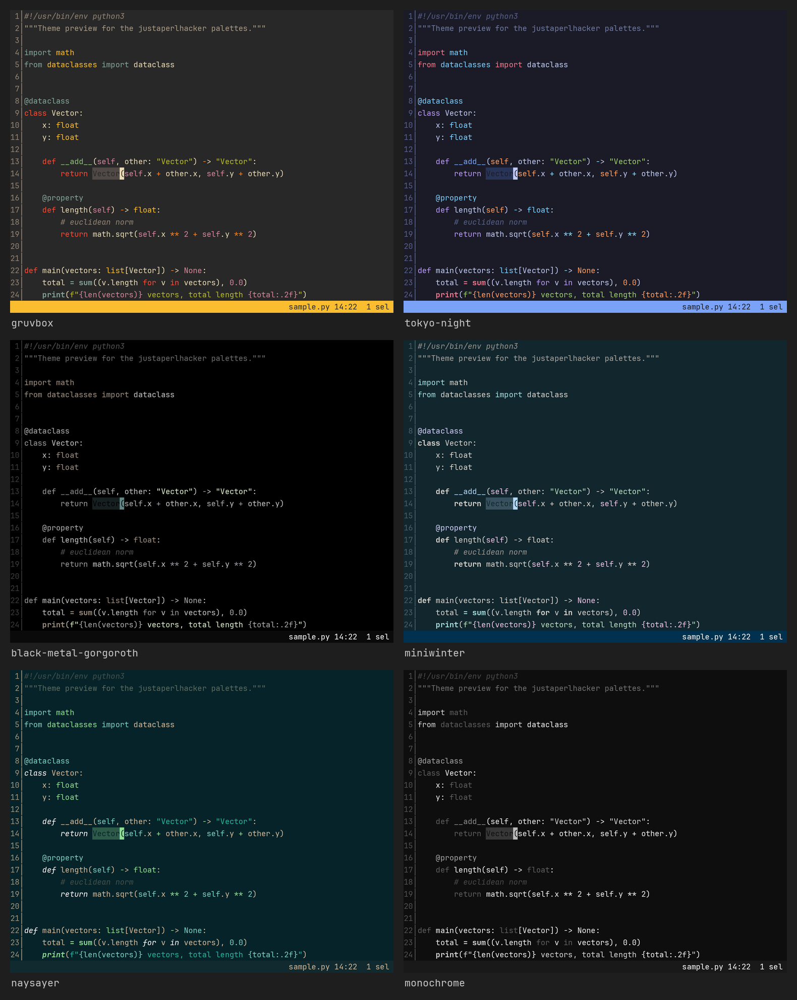
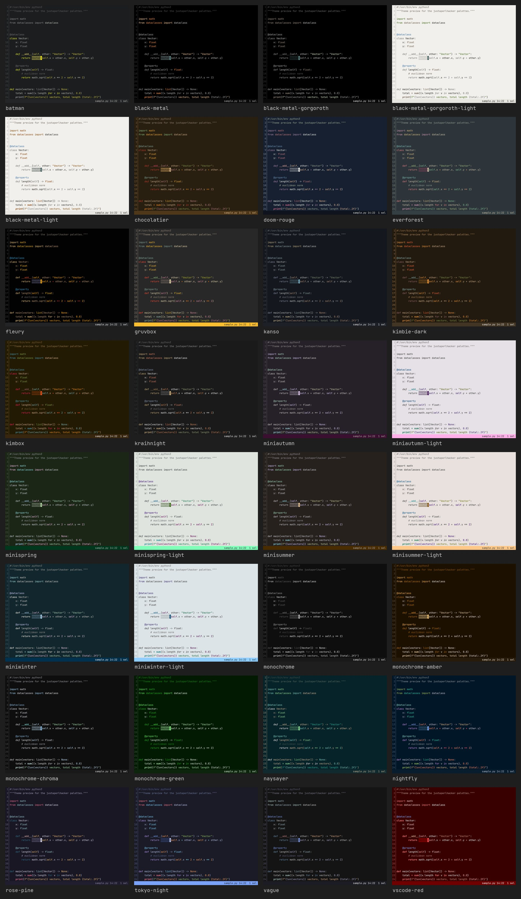

# justaperlhacker Kakoune Themes

A collection of low-saturation color schemes for the
[Kakoune](https://kakoune.org) editor, ported from the matching
[Fresh](https://github.com/sinelaw/fresh), Neovim, VS Code and Doom Emacs
themes — plus the complete color-scheme set from the
[10x Editor](https://10xeditor.com) — so every editor in the family shares
one palette.

All themes live in [`colors/`](colors/) and are plain Kakoune `face`
definitions, so they work with any terminal that supports truecolor.

## Included themes

Light/dark pairs:

- **Black Metal**
- **Black Metal Gorgoroth**
- **Miniautumn**
- **Minispring**
- **Minisummer**
- **Miniwinter**

Dark themes:

- **Batman**, **Chocolatier**, **Doom Rouge**, **Everforest**, **Fleury**,
  **Gruvbox**, **Kanso**, **Kimbie Dark**, **Kimbox**, **Kraihnight**,
  **Monochrome** (plus **Amber**, **Chroma**, **Green**), **Naysayer**,
  **Nightfly**, **Rose Pine**, **Tokyo Night**, **Vague**, **VSCode Red**

10x Editor ports (all prefixed with `10x-`):

- **Abyss**, **Amber**, **Blue Green**, **Blue Purple**, **Brassica**,
  **Cantaloupe**, **Cyan**, **Firefly**, **Github Dark**, **Gold**,
  **Green Screen**, **Grey**, **Gruvbox Dark**, **High Contrast**, **Icing**,
  **Kanagawa**, **Lichen**, **Light**, **Material Dark**, **Midnight**,
  **Mono Grey**, **Monokai**, **Moriarty**, **Moss**, **Multi-coloured**,
  **Neon**, **Noctiluca**, **Orange**, **Orange Kyle**, **Pastel**, **Pink**,
  **Quad Tone**, **RDRDark**, **Solarized Dark**, **Solarized Light**,
  **Spice**, **Sunset** (the 10x default), **Terracotta**, **VS Classic**,
  **VS+VAX**, **VS+VAX Light**

## Screenshots

A curated selection (Gruvbox, Tokyo Night, Black Metal Gorgoroth, Miniwinter,
Naysayer, Monochrome):



The original gallery (the 10x ports are not yet included in this montage):

[](screenshots/all.jpg)

Every shot is a real Kakoune frame (buffer, line-number gutter, a selection and
the status line) captured through Kakoune's JSON UI — see
[`make screenshots`](#development). Full-resolution PNGs live in
[`screenshots/`](screenshots/).

## Install

Copy or symlink the `colors/` directory into your Kakoune config:

```sh
make install              # -> $XDG_CONFIG_HOME/kak/colors (default ~/.config/kak)
# or
mkdir -p ~/.config/kak
ln -s "$PWD/colors" ~/.config/kak/colors
```

Then select a theme from inside Kakoune:

```
:colorscheme gruvbox
```

To make it your default, add it to `~/.config/kak/kakrc`:

```kak
colorscheme gruvbox
```

If you use a plugin manager that supports Kakoune (e.g. `plug.kak`,
[`kakoune-plug`](https://github.com/andreyorst/plug.kak)), point it at this
repository and it will pick up `colors/` automatically.

## Development

The themes are generated from the source palettes in [`palettes/`](palettes/)
(fresh-editor JSON, Neovim mini.hues Lua, VS Code color-theme JSON, and 10x
Editor `.10x_settings` files).

```sh
make generate      # regenerate colors/*.kak
make validate      # source every theme with kak to catch syntax errors
make screenshots   # render screenshots/*.png and the montages
make list          # list available themes
```

`make generate` requires Python 3 (standard library only). `make validate`
requires a `kak` binary (override with `KAK=/path/to/kak`). `make screenshots`
additionally requires Python's Pillow and a monospace font (JetBrains Mono by
default); it drives `kak -ui json` and rasterizes the resolved faces.

## Adding a theme

1. Drop a fresh-editor palette into `palettes/fresh/<name>.json`, a
   VS Code color-theme JSON into `palettes/vscode/<name>-color-theme.json`
   (register it in `VSC_THEMES` in `scripts/gen_themes.py`), **or** a 10x
   settings file into `palettes/10x/<name>.10x_settings`.
2. Run `make generate`.

The renderer maps the normalized palette onto Kakoune's code, markup, UI and
diff faces; the palette normalization is shared with the Doom Emacs generator
so the colors stay identical across editors.

## License

[MIT](LICENSE) © 2026 justaperlhacker
